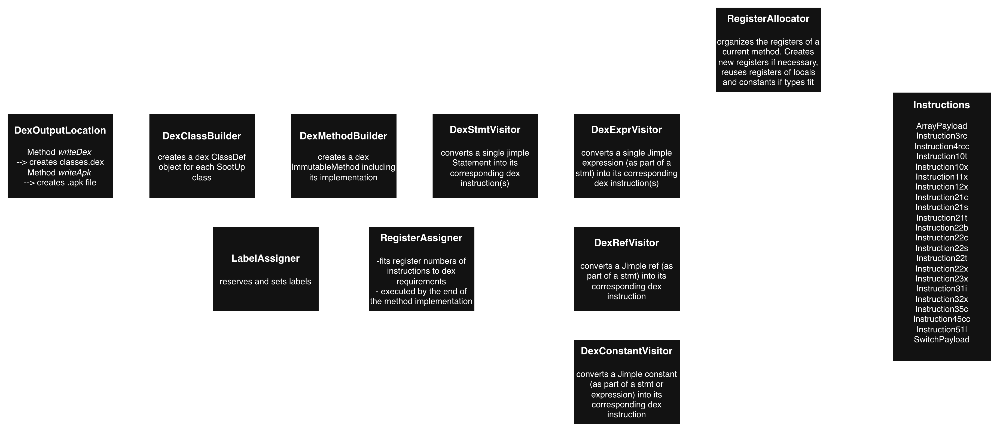

# sootup.apk.backend

## Class Structure

## Usage

The class `DexOutputLocation` serves as the entry point to the sootup.apk.backend. 
It provides two methods for converting a SootUp JavaView (created from an ApkAnalysisInputLocation) into Android bytecode:
- `writeDex` generates a classes.dex file containing all classes in Android bytecode.
- `writeApk` generates an APK file containing the classes.dex and the additional files of the input APK. 
The APK still needs to be aligned and signed.

## Implementation Details

### DexMethodBuilder

The class `DexMethodBuilder` is responsible for creating a DEX `ImmutableMethod` for each `SootMethod`, including its 
implementation.

In order to generate the method implementation, SootUp's control-flow graph is utilized. 
Starting at the startingStmtBlock of the controlFlowGraph, the method `createMethodImplementation` processes each block 
and adds its exceptional and non-exceptional successors to a worklist of blocks that still need to be processed.

Within each block, SootUp `Stmts` are converted to intermediate DEX instructions, as described more in detail in the 
following section *Instructions*.

Additionally, register handling accross blocks must be managed, as explained in the section *Register Organization*.

### Instructions

SootUp `Stmt` objects are not directly translated into dexlib2 `BuilderInstruction` objects, but instead using 
intermediate `AbstractInstruction` objects, which are defined in the `instructions` directory.
This approach is similar to the one used in Soot's toDex implementation.

Using intermediate `AbstractInstruction` objects offers multiple advantages, such as allowing register numbers to be 
changed and labels to be assigned and set dynamically.

The conversion is implemented in the `DexMethodBuilder` as follows:
1. The method `createMethodImplementation` converts SootUp `Stmt` objects into intermediate `AbstractInstruction` 
objects using the `DexStmtVisitor`.
Each `AbstractInstruction` contains the DEX Opcode, the required registers (represented by `Register` objects rather 
than final register numbers), as well as additional payloads, values, and target statements.
2. The method `addBuilderInstructions` then converts each `AbstractInstruction` into the corresponding 
dexlib2 `BuilderInstruction` objects.

The conversion follows a one-to-many relationship: a single SootUp `Stmt` may be translated into one or multiple `BuilderInstruction` objects.

### Label Organization

Labels in Android bytecode mark jump targets, for example in if and switch statements, was well as in exception handling.
SootUp uses a similar concept by marking specific `Stmt` objects as jump targets. Therefore, label organization is 
handled as follows:

1. When SootUp `Stmts` are converted into intermediate `AbstractInstruction` objects, their mapping to the original 
Stmt is preserved in the `instructionMap` of the `DexMethodBuilder`.
2. Once all AbstractInstructions have been created, the `LabelAssigner` reserves labels for all target statements.
3. The `addBuilderInstructions` method in the `DexMethodBuilder`then converts the AbstractInstructions into the 
corresponding dexlib2 builder instructions.
For each instruction, the `LabelAssigner` checks whether a label has been reserved for its corresponding SootUp `Stmt`.
If this is the case, the label is placed *before* the corresponding builder instruction.
Only if the label belongs to the *end of a try block*, the label is placed *after* the corresponding instruction.

### Register Organization

The register organization is implemented as follows:
- The class `Register` represents an intermediate register object, and is identified by a temporary register *number*, 
a register *type*, and a flag indicating whether it stores a *parameter*.
The register type is important because the Android Verifier strictly checks the type consistency of register values.
- The class `RegisterAllocator` is responsible for the creation and re-use of registers when generating 
AbstractInstruction objects. 
In principle, each SootUp `Local` is assigned to one dedicated `Register`. 
The RegisterAllocator uses a *registerMap* to check whether a local has already been assigned a register.
For (temporary) `Constant` objects that are not assigned to a local, the `RegisterAllocator` maintains a *ConstantPool* in order to re-use registers for 
constants of the same type used in different parts of a method.
- The class `RegisterAssigner` assigns the *final* register numbers and instruction opcodes. 
This is necessary because DEX instructions can only access specifc register ranges; for example, many instructions 
can only address registers 0-15.
If a method requires more than fifteen register, the `RegisterAssigner` first calculates the amont of required temporary registers 
to keep a number of small register numbers free. 
For instructions that reference registers outside their addressable range, additional *move* instructions are inserted 
to copy the values into accessible registers and, where necessary, copy the results back to their original registers.

While there is currently a register re-use for temporary constants, there is currently no register re-use of registers 
of (no longer used) locals. Consequently, the generated bytecode generally requires more registers 
than the original Android bytecode.

However, this approach becomes more complex when handling SootUp locals of type *java.lang.Object*, 
as described in the section 'Handling of type java.lang.Object'.

### Annotations

SootUp currently stores class, method, and field annotations in `AnnotationUsage` objects.

Android bytecode supports three annotation visibility levels: `Build`, `Runtime`, and `System`. 
The current apk.frontend only converts `Build` and `Runtime` visible annotations into the SootUp model. 
The apk.backend converts these annotations back into Android bytecode in a similar manner, using the DexClassBuilder and 
DexMethodBuilder classes.

Annotations of the visibility `System` are not represented in the current SootUp model, including the annotations
EnclosingClass, EnclosingMethod, InnerClass, MemberClasses, Throws, and Signature. The apk.backend implementation 
attempts to reconstruct some of these annotations. However, the information available in the SootUp model is not always 
sufficient to reproduce all annotations.

Additionally, method *parameter* annotations are currently not modelled in SootUp and consequently 
cannot be restored by the apk.backend.

Although some annotations may be lost during this process, their presence is not strictly required for an APK 
to execute successfully. Therefore, missing annotations do not necessarily prevent the resulting APK from running correctly.

### Initial Field Values

In android bytecode, static class fields may be initialized with a value, e.g., `.field public static final ANCHOR_BASELINE:I = 0x4`.
The init values (e.g., 0x4) are currently not represented in the SootUp model, 
although these values are required for an android app to run.
Therefore, the apk.frontend was adjusted by storing the init value (in its raw EncodedValue format) 
in a field annotation with the class name "initialValue". The value is then accessed in the apk.backend DexClassBuilder.

## Open Issues

### Handling of type java.lang.Object

Although registers in Android bytecode are generally untyped, the Android verfier strictly checks type consistency
throughout the data flow.
Therefore, the actual type of each variable must be known to generate the correct instructions,
such as MOVE instructions for primitive values and MOVE_OBJECT for object references.

In principle, the `TypeAssigner` used by the `ApkAnalysisInputLocation` infers the type of each variable.
However, several cases have been observed in which the inferred type is `java.lang.Object`,
even though the actual value is primitive (e.g., `$u5_5 = (java.lang.Object) 1;`) and only later assigned to its
actual type (e.g., `#l1 = (boolean) $u5_5;`).

In such cases, it cannot be relied on the information given by `local.getType()` to determine the actual type of the
value, as it would  return java.lang.Object (even though primitive types do not inherit from this type).
Generating a MOVE_OBJECT instruction for a register containing a primitive value would cause the Android verifier to
reject the bytecode.

This situation becomes particularly challenging when a local holds an object reference in one part of a method and a
 primitive value in another. Instead of relying solely on the declared *java.lang.Object* type,
the apk.backend must therefore track the actual type of each variable throughout the control-flow graph.
Handling block merge points, where a variable may have different types along different incoming paths, is especially complex.

The current apk.backend implementation handles such cases as follows:

- Whenever a new variable is created (and its declared type is java.lang.Object),
  the *actual* type, inferred by its assigned value, is stored in the `Register`
  rather than the declared type of the corresponding local.
- If an existing local is assigned a value with a different actual type, a *new* register with the appropriate type
  is allocated using the method getRegisterForValueWithNewType. Consequently, a single local may now be associated
  with *multiple* registers of different numbers.
- A register map tracks the register *currently* assigned to each local. Register maps are maintained
  at three points of each block: the beginning, the end, and exceptional block exits (e.g., after the second-to-last statement).
- If a block has multiple predecessors, a local may be associated with *different registers* along different incoming paths.
  If a local is used later in the control flow graph (checked using the method `isUsedLater`), these registers must be
  merged into a common register. This is archived by inserting move instructions at the predecessors
  (implemented via the method `mergeIncomingRegisterMaps`).
- If a successor block has already been processed, the current register map must be reconciled with the successor's
  register map. Necessary move instructions are inserted by the method `mergeCurrentRegisterMapToSuccessor`.

The current implementation is complex and error-prone.
If SootUp's TypeAssigner can reliably ensure that a local is assigned to the type `java.lang.Object` only when its
value is consistently an object reference throughout the method, the implementation could be significantly simplified
by only keeping one global register map per SootUpMethod, while removing the complex helper functions
(mergeIncomingRegisterMaps, mapCurrentRegisterMapToSuccessor, fixObjectType, getRegisterForValueWithNewType).

### Casts of uninitialized objects

When converting Jimple statements to DEX instructions, type casts require special consideration.
The dexBodyInterceptors used by the ApkAnalysisInputLocation may insert *additional casts* into the jimple code that were
not present in the original Android bytecode.
While this practice is generally unproblematic, the Android Verifier rejects *check-cast* instructions on *uninitialized objects*.

This issue is currently handled in a relatively simple approach:
- Each `Register` object has an attribute *isInitialized* (default value is true)
- When a `JNewExpr` is processed or a `JThisRef` is used in a constructor (with the method name '\<init>'),
  the corresponding register's *isInitialized* value is set to *false*
- At constructor calls (invoke_direct opcode), the *isInitialized* value of the base register is set to *true*
- For move instructions, the source register's *isInitialized* value is copied to the target register
- At check-cast instructions, the *isInitialized* value of the affected register is checked. If the value is false, a move instruction is generated instead of the cast

However, the current approach does not consider cases where the initialization happens in an *aliased* local (where the alias is referenced before the JNewExpr).
In such cases, no check-cast instructions are created for the respective object, even though they are required for type consistency. 
Therefore, a typestate analysis across aliases would be needed to reliably determine whether an object has been initialized.

